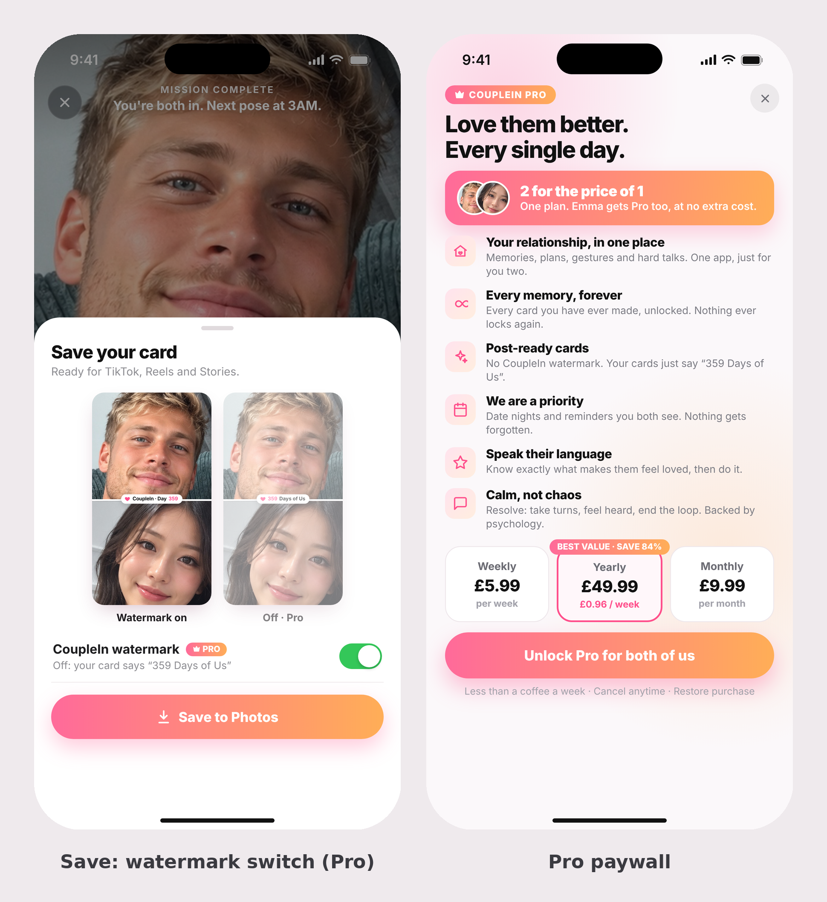
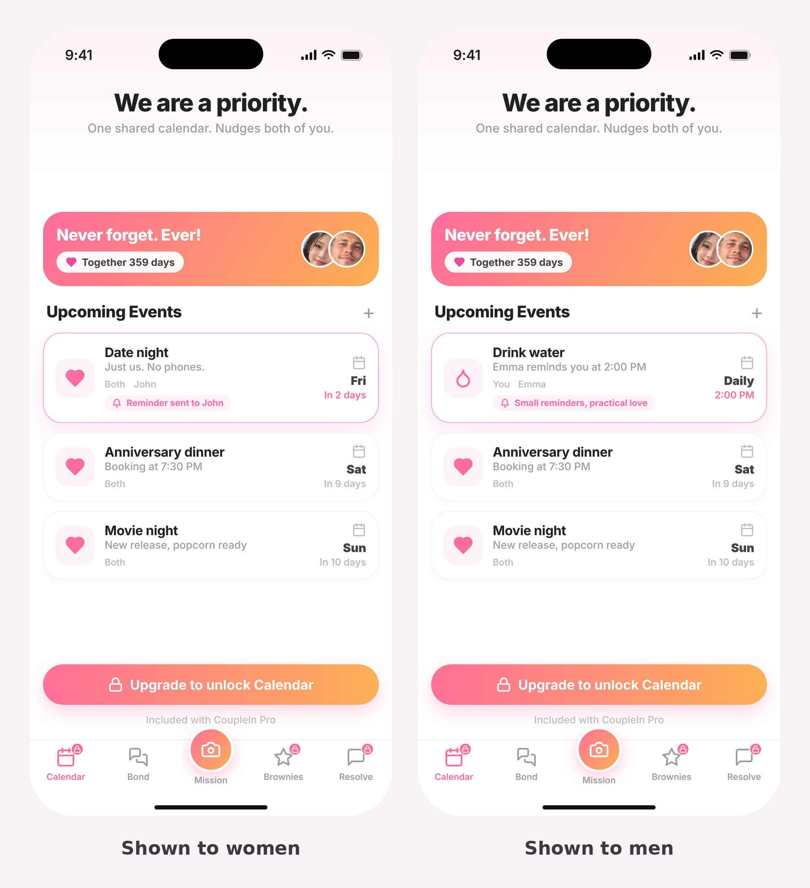
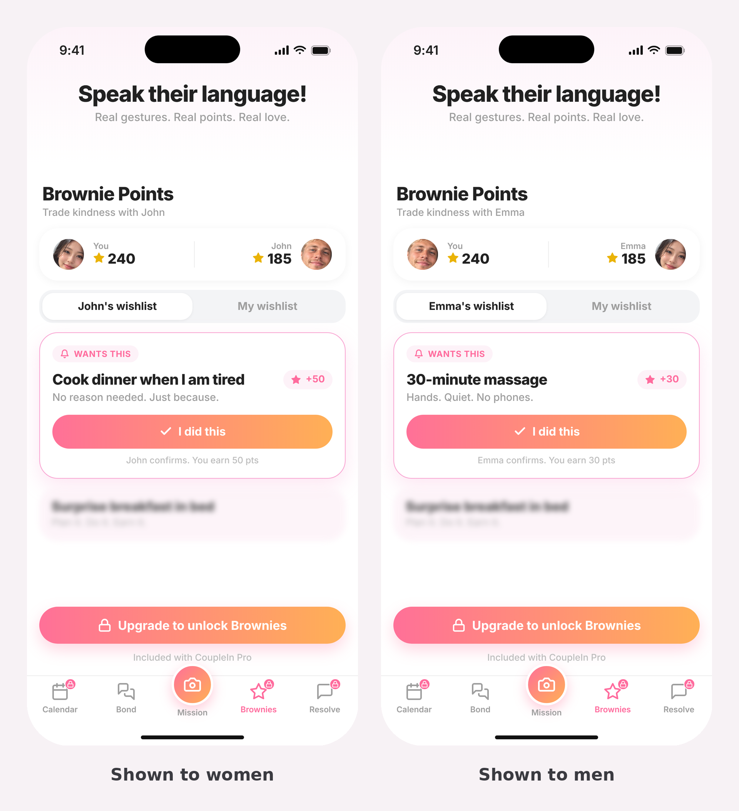
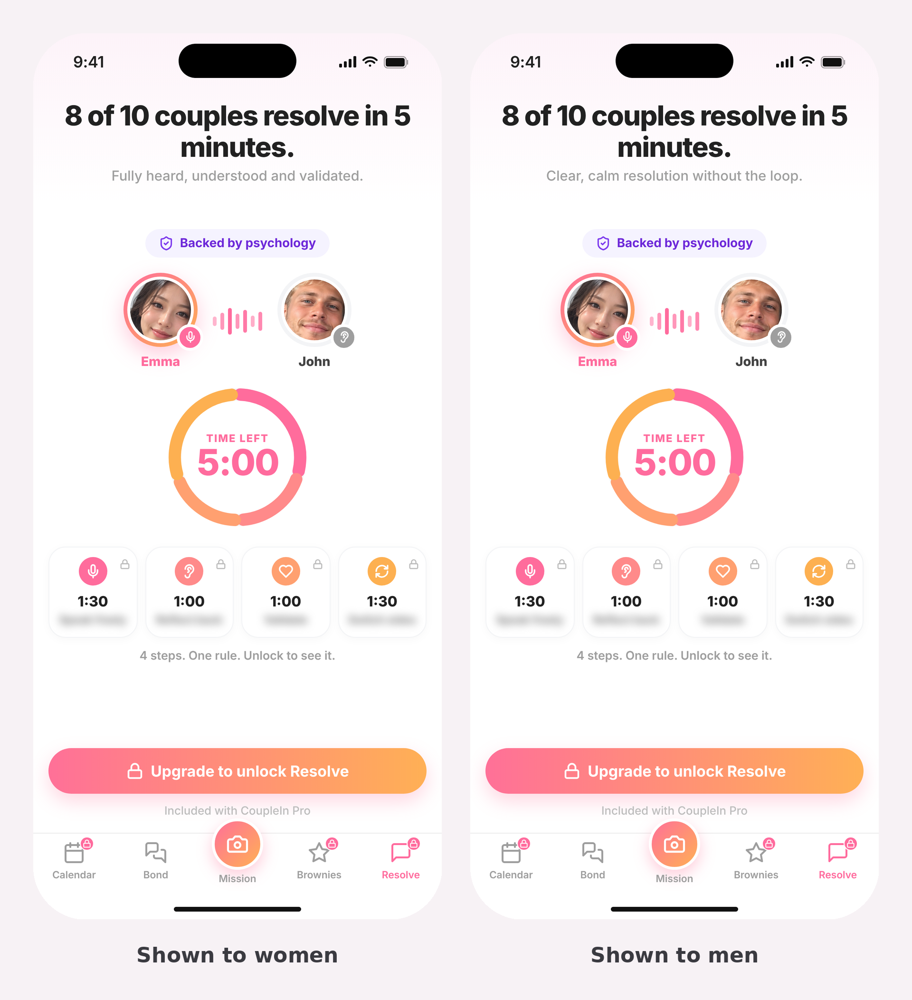
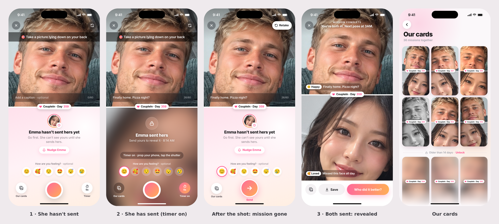
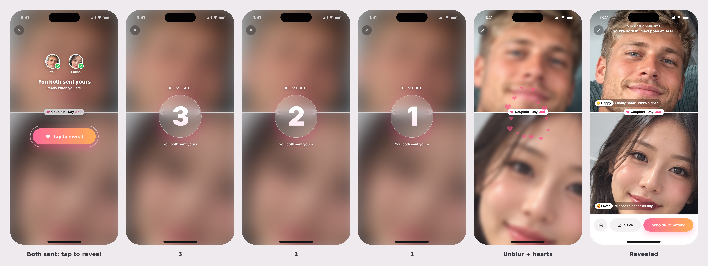
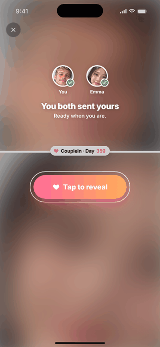
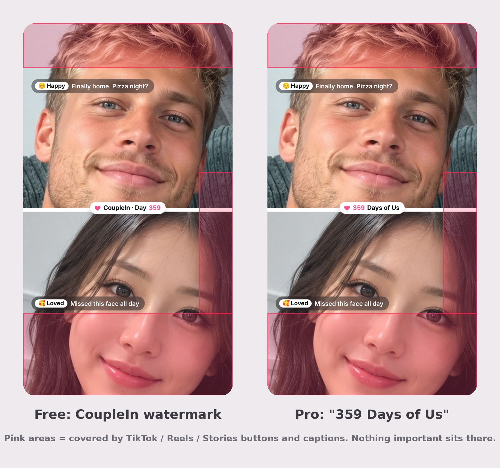
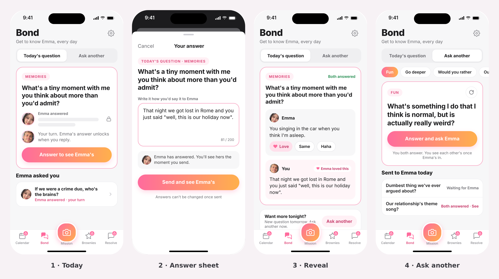

# Final Plan: Developer Spec (Mission MVP)

Oct 10, 2026

## 1. Scope

Mission is the MVP: one pose a day, both partners send a selfie, a 3-2-1 reveal shows both, and the card can be saved or posted. Everything else in the app is Pro and shown as a locked placeholder.

**In the MVP**

- One pose a day, the same pose for both partners, starting at Pose 1 (a list of 365).
- Onboarding with an invite fork, a safety promise before the first selfie, and a hard gate: no other screen until the first selfie is sent.
- Mutual lock and a 3-second "Reveal" countdown before every reveal.
- Save card and "Who did it better?" (opens the share sheet).
- A Week 1 video generated on the phone after the 7th completed pair.
- Photos stored on the phone, last 14 days viewable on Free, with a short-lived server relay to deliver photos between phones.
- Bond, the free daily-question page (section 8). Gated placeholder pages for Calendar, Brownies and Resolve, and a redesigned pricing page.

**Cut from the MVP (do not build)**

- Saturday global challenge or any second daily card.
- Streaks, streak passes, missed-day tiles, mood-only posts (a mood without a photo).
- "Who did it better" voting and scoreboard.
- Cloud photo storage beyond the relay.

Terms: **Relationship Day Count** is days since the start date entered by the first downloader (shown as "Day 256 together"). **Pose number** counts completed poses and is independent of the Day Count. The app says "send", never "post".

## 2. Navigation, Free vs Pro, pricing and placeholders

Mission replaces Mood Sync as the centre of the app and is a free feature (with Bond, below), with no limit on daily use (the habit is the product). The only thing gated is viewing old photos: Free can open the last 14 days; anything older is Pro. The app opens on the camera, or on today's card if today's selfie is already sent.

**Tab bar (left to right):** Calendar (Pro), Bond (free), Mission (free, centre, raised camera button), Brownies (Pro), Resolve (Pro). Settings moves out of the tab bar to a gear icon at the top right of every screen. Pro tabs keep the pink lock badge. The Mission (today's pose, camera, reveal) lives in the centre Mission button. **Bond** is a free page: a daily question, an "Ask another" tab with category chips (Fun, Go deeper, Would you rather, Our future, Memories), and a reveal where both partners' typed answers (200 characters) show together once both have answered. No chat, no history in v1. Full Bond spec and screens in section 8. Question bank spec: see the "CoupleIn Bond: Question Bank" doc.

| Area | Free | Pro |
| --- | --- | --- |
| Mission: daily pose, send, reveal, share card | Yes | Yes |
| Past cards | Last 14 days | All, from the phone's storage |
| Bond: daily question, Ask another, reveal | Yes | Yes |
| Calendar, Brownies, Resolve | Locked placeholder | Yes |
| Watermark on cards and Week 1 video | Yes | Removed |

**Pricing**

| Plan | Price |
| --- | --- |
| Weekly | £5.99 |
| Monthly | £9.99 |
| Yearly | £49.99 |

Redesign the pricing page to show all three plans, with Yearly highlighted. **Open:** whether Pro is per person or per couple (recommended: per couple).

**Pro paywall.** Built as an offer so good that not buying feels silly. Header pill "COUPLEIN PRO", title "Love them better. Every single day." Directly under the title, the most visible element on the page: a full-width pink banner **"2 for the price of 1 · One plan. [Partner] gets Pro too, at no extra cost."** with both partners' profile photos. Then the value stack, each with an icon, a bold line and one sentence:

1. **Your relationship, in one place.** Memories, plans, gestures and hard talks. One app, just for you two.
2. **Every memory, forever.** Every card you have ever made, unlocked. Nothing ever locks again.
3. **Post-ready cards.** No CoupleIn watermark. Your cards just say “N Days of Us”.
4. **We are a priority.** Date nights and reminders you both see. Nothing gets forgotten. (Calendar)
5. **Speak their language.** Know exactly what makes them feel loved, then do it. (Brownies)
6. **Calm, not chaos.** Resolve: take turns, feel heard, end the loop. Backed by psychology.

Plans side by side: Weekly £5.99, **Yearly £49.99** (pre-selected, tag "BEST VALUE · SAVE 84%", "£0.96 / week"), Monthly £9.99. Button "Unlock Pro for both of us". Small print "Less than a coffee a week · Cancel anytime · Restore purchase". Rules: no unverified statistics on this screen (add real reviews and couple counts once they exist); the Week 1 video is not part of the offer for now; "2 for the price of 1" and "for both of us" depend on Pro being per couple (open item 2).

**Gender at sign-up.** Asked on the name step, only to choose which placeholder is shown on the locked tabs. Options: Woman, Man, Prefer not to say (neutral version, shows either). The field is optional.

**Locked placeholders.** Each locked tab shows one demonstration page in the app's existing style, with a lock badge on the tab and a button "Upgrade to unlock [tab]". Left image is the women's version, right is the men's version.

| Tab | Promise line | What it shows |
| --- | --- | --- |
| Calendar | We are a priority. | The Calendar screen with one reminder highlighted (date night for women, drink water at 2PM for men) |
| Brownies | Speak their language! | The Brownies screen with one wishlist item highlighted (cook dinner when I am tired for women, 30-minute massage for men) and its "I did this" button |
| Resolve | 8 of 10 couples resolve in 5 minutes. | A teaser only: who is speaking and listening, a timed 5-minute ring in four turns, four locked steps showing timings only with blurred names, and a "Backed by psychology" badge. Do not reveal the method on this screen. |

The figure on the Resolve promise is a placeholder and is not verified. Replace it when real data exists.

## 3. Daily pose rules

One thing a day, every day. Each couple walks a fixed list of 365 poses in order, starting at Pose 1, at their own speed. The list has no calendar dates, so nothing refers to months, holidays or seasons.

1. A couple has one current pose number. Both partners always get the same pose.
2. A new pose unlocks at 3AM in the couple's shared timezone, but only after both partners have sent the current one.
3. If a day is missed, the couple stays on that pose. Nothing expires and nothing is lost.
4. The Relationship Day Count keeps advancing every day and is independent of the pose number.
5. Neither partner can see the other's photo until both have sent (mutual lock).
6. Every photo sent earns 25 points, whether or not the partner has sent.
7. There is no second daily card and no weekly special task in the MVP.

**Pose list.** The rebuilt list is Final-Plan-Pose-List.xlsx (Pose 1 to 365, no Month column). Pose 1 is "Take a picture lying down on your back." Every pose is free to do, every day, for as long as the couple wants: nothing about doing the daily pose is ever locked. Only viewing old photos is Pro (section 6). The first 7 poses feed the Week 1 video. In-app poses must be safe to do at home: no roads, roofs, edges or water.

## 4. Onboarding

The promise made before any photo is taken: neither partner can see the other's selfie until both have sent. The app says "send", never "post".

**Hard gate.** Neither partner can reach any other screen until they have sent their first selfie. There is no skip, "Not now" or "Remind me later" on the selfie. If the app is closed it reopens on the camera. The only other exit is Settings, to grant camera permission. (Whether the gate also applies to later daily poses is an open item, section 8.)

**Step 0: fork (after the opening animation and sign-in)**

"Do you have an invite code from your partner?"

- **Yes, I have a code**: Flow B. A deep link pre-fills the code and skips this screen. Invalid: "That code doesn't match anyone. Check with [Partner Name] and try again." Expired: "Ask [Partner Name] to send a new invite."
- **No, I'm starting first**: Flow A as User 1.
- **Skip, I'll enter it later**: Flow A as if User 1, with "Have a code? Enter it here" on the waiting screen. Late-connection rules in section 7 apply.

**Flow A: User 1 (first downloader)**

1. **Opening animation**, 5 seconds, two blurred faces with a lock between them: "One selfie a day. Both of you. Unlocked together."
2. **Sign in** with Apple or Google, unchanged.
3. **Name and gender.** "What should we call you?", pre-filled from the social account, skippable (falls back to the account name, then "You"). Gender options: Woman, Man, Prefer not to say. Basic banned-word filter.
4. **Partner name**, required.
5. **Relationship start date**, required. Date picker, with "I don't remember exactly" falling back to month and year (stored as the 1st). No future dates, nothing before 1970. Editable later in Settings.
6. **Safety promise**, before any camera. Two phones facing each other, a locked photo on each, an arrow "both unlock together". Copy: "Before you send your first selfie. Your selfie stays private. [Partner Name] cannot see it, and you cannot see theirs, until you have both sent. There is no way to peek. Not even we can unlock it early." Button: "Got it, let's send Pose 1". Link: "How does this work?" opens a one-line modal. Not skippable.
7. **Camera, Pose 1** (section 5). No skip.
8. **Card preview and lock.** Their selfie on the card, "Day 256 together", "Pose 1", partner's side blurred with a lock. "Your selfie is locked. [Partner Name] still can't see it. Send them an invite so they can send theirs, then both unlock at the same time." Buttons: Invite [Partner Name] / Remind me later.
9. **Compliment.** "What's one thing you love about [Partner Name]?" Free text, with three suggestions after 5 seconds of nothing. Basic banned-word filter.
10. **Share screen.** Message: "Hi [Partner Name], [Your Name] loves that you are so [compliment]. They made a selfie just for you. Send yours to unlock it." The blurred locked card is attached as an image. Buttons: Share to WhatsApp / Copy link / Remind me later.
11. **Waiting screen.** Own locked card, "Waiting for [Partner Name] to join." Send reminder. Further selfies stack as locked and unlock when the partner joins. Warning: "Your selfies live on this phone. Don't delete the app until [Partner Name] joins."
12. **Push when the partner sends:** "[Partner Name] just sent theirs. Tap to reveal."
13. **Countdown:** Tap to reveal, then "Reveal" "3... 2... 1..." (section 5), then the reveal. Buttons: Save card / Who did it better?
14. **Week 1 video promise.** "Send 7 poses and we'll make you a video of your first week."

**Flow B: User 2 (partner, arrives by invite)**

1. Invite link goes to the store listing, or opens the app, carrying the invite token. It must land on the locked card (step 4), not a bare store page.
2. Sign in.
3. Name and gender only. Partner name and start date are inherited from User 1.
4. **Locked card and safety promise.** The exact card User 1 made, their face blurred under a lock, "Day 256 together". "[Partner Name] is waiting. You will be able to see [Partner Name]'s selfie once you send yours. Your selfie stays private too." Button: Send today's selfie. No "Not now": the app stays here until they send.
5. Camera, Pose 1. No name, date or code fields.
6. Countdown, reveal, the Week 1 video promise, then the same compliment and share step as User 1 (optional), then the normal app.

## 5. Camera, reveal, share card and Week 1 video

**Camera screen.** Full screen, tab bar hidden, X at top-left (only after the first selfie is sent), front camera, saved photo not mirrored. Layout follows the "First selfie" mock below: the photo fills the top half, the white line carries a "Day N together" pill, the partner's panel (locked, or invite) sits below.

**Mission screen: three states.** The centre Mission tab opens straight into this full-screen camera. No tab bar, no header bar: the camera runs edge to edge. Your live camera fills the top half, the partner's half fills the bottom, the white line between them carries the "CoupleIn · Day N" pill. Top-left X (back to the app), top-right flip camera (becomes Retake after the shot), today's mission shown as a Snapchat-style caption bar across the live camera (see Mission on the camera). Bottom row in every camera state: "Our cards" button (bottom-left: a clean stacked-cards icon in a round button with the label "Our cards", same style as Flip; opens the gallery), shutter (centre), 5s timer (bottom-right, labelled "Timer").

1. **Partner has not sent.** Partner half is a soft pink-to-peach gradient (never black) with the partner's profile photo in a gradient ring, "Emma hasn't sent hers yet", "Go first. She can't see yours until she sends hers." and a white "Nudge Emma" button (sends a push; limit one nudge per 3 hours).
2. **Partner has sent.** Partner half shows her photo heavily blurred with a frosted lock: "Emma sent hers" and "Send yours to reveal it · 8:14 AM". The blur is a local placeholder; the real photo is only released by the relay after you send (section 6).
3. **Both sent (revealed, after the 3-2-1 countdown).** Both photos clean with their caption + mood pills. Top reads "Mission complete / You're both in. Next pose at 3AM." Actions sit in a white strip below the photos and never cover them: Our cards icon, Save, Who did it better?.

**Retake.** After the shutter, the camera freezes on the photo and the controls change: the flip button at the top-right becomes a white **Retake** button, and the shutter becomes a pink **Send** button (arrow). Retake goes back to the live camera and discards the photo; retakes are unlimited before sending. After sending, a "Retake" link stays available until the partner has sent: the new photo replaces the old one on the relay and the old copy is deleted. Once both have sent (the reveal has happened) the photo is final. The timer setting, caption, mood and pose stay the same across retakes.

**Mood and caption (both optional).** Neither is ever required to send.

- **Mood:** a row of six emoji above the shutter, labelled "How are you feeling? · optional" (😊 Happy, 🥰 Loved, 😌 Calm, 🤩 Excited, 😴 Tired, 😢 Sad). Tap to select (pink ring), tap again to clear. Can be picked before or after the shutter, up until Send.
- **Caption:** a frosted field at the bottom of your photo, "Add a caption · optional", 60 characters with a counter. Empty by default.
- **On the card:** the mood and caption show together as one pill on that person's photo ("😊 Happy · Finally home. Pizza night?"), placed inside the social safe zone (see Share card). Nothing is shown if they were skipped. Both appear on the reveal, the share card and Our cards.
- Both stay hidden from the partner until the reveal, exactly like the photo, and travel with the photo through the relay. On a retake they are kept unless the user changes them.

**Field of view (not too close).** Open the front camera at its widest setting: on iPhone use the widest available zoom factor of the front camera (the "zoomed out" view on iPhone 11 and later), on Android pick the widest front lens / minimum zoom ratio in CameraX. Never default to a cropped or zoomed view, and never crop the photo to fit the half-screen; fill the frame from the widest image. Optional: on-device face detection shows a small "Move the phone back a little" hint if a face fills more than about 60% of the frame (hint only, never blocks the shutter). For poses that need distance, the 5s timer is the answer.

**Mission on the camera (Snapchat-style).** Today's mission is shown only while the user is taking the picture, as a Snapchat-style caption bar across the live camera: full width, black at about 50% opacity, white centred text, for example "🎯 Take a picture lying down on your back". It sits just under the X and flip buttons so it covers as little of the face as possible. The same text is in the daily notification.

- It is part of the camera screen only. It is **never** in the photo, never on the card, and never on the share image.
- It disappears the moment the shutter fires (or the 5s timer reaches zero) and stays hidden on the Retake / Send preview. Retake brings it back with the live camera.
- Because the mission is never on the card, there is nothing to remove when saving. The only thing a user can turn off when saving is the watermark (Pro).

**5-second timer (hands-free). An optional tap, never automatic.** Many poses need both hands or the phone held at a distance, so the camera has a round "5s" timer button at the bottom-right, opposite Our cards, easy to reach with the thumb. The user chooses, every time, whether to use it. It is OFF by default and normal photos are unchanged: tap the shutter, photo is taken instantly.

How it works, using the timer button at the bottom-right of the Mission screen:

1. **Timer off (default).** The bottom-right button is white with a stopwatch and "5s", labelled "Timer". The shutter takes the photo immediately.
2. **User taps the timer button to turn it on.** It turns pink, the label becomes "Timer on", and a hint appears above the shutter: "Timer on · prop your phone, tap the shutter". Nothing starts yet. Tap the button again to turn it off.
3. **User taps the shutter.** A large 5, 4, 3, 2, 1 counts down over the camera with a light tick or haptic each second; the hint reads "Photo in 3… tap to cancel". Tapping the shutter or the timer button cancels. At zero the photo is taken automatically and the Retake / Send preview shows.

After the photo the timer switches itself back off, so the next photo is a normal tap unless the user chooses the timer again. The rest of the flow is identical to a normal selfie (caption, send, lock). Optional: when a pose needs distance or both hands, show "Needs both hands? Try the 5s timer" under the pose prompt, which only points at the button and never turns it on. This is separate from the 3-second "Reveal 3, 2, 1" countdown, which only plays before the reveal.

**Camera permission denied.** Explain why and link to Settings. A gallery fallback is allowed only in this case, with a warning.

**Tap to reveal (the user starts it).** The reveal never plays on its own. As soon as both partners have sent, each partner lands on a "ready" screen (from the camera, from the "[Partner] just sent theirs" push, or when they next open the app): both photos in place but heavily blurred (about 34px), the white line and Day pill between them, both profile photos with green ticks, "You both sent yours" and "Ready when you are.", and one big pink button, **♥ Tap to reveal**, sitting just under the line with a soft pulsing ring around it. Only the X is shown otherwise. Each partner taps their own button; one partner revealing does not reveal for the other. If the user leaves without tapping, they come back to this same screen.

**Reveal countdown (animated).** Starts the moment the user taps the button (the button presses in to 95%). Full screen: no tab bar, no header text, no action buttons, only the X. Centred over the line: "REVEAL" in spaced capitals, a frosted-glass circle with the number, and "You both sent yours" underneath.

1. **3, 2, 1.** One second per number. Each number pops in at 125% and settles to 100% in about 250ms, with a light haptic on each.
2. **Reveal.** After 1 the circle fades, both photos unblur over about 0.8s, and a burst of small pink hearts flies out from the Day pill on the line.
3. **Revealed.** The caption and mood pills, the header "Mission complete / You're both in. Next pose at 3AM." and the white action strip (Our cards, Save, Who did it better?) slide in.

No skip. It runs from local state with no network dependency: both photos are already on the phone and the combined card is cached before the countdown starts, so there is no spinner. If the app is closed mid-countdown, reopening lands on the revealed screen. If the user opens the app or taps the push hours later, they land on the Tap to reveal screen and the countdown plays when they tap. "Who did it better?" never appears during the countdown.

**Reveal screen.** Both photos clean, each with its caption + mood pill ("😊 Happy · Finally home. Pizza night?"), the Day pill on the line, the header "Mission complete / You're both in. Next pose at 3AM.", and the white action strip under the photos (it never covers them): Our cards, **Save** (opens the Save sheet) and **Who did it better?** (opens the Save sheet, then the share sheet).

**Share card.** 1080 x 1920 (9:16) PNG, built on the phone when Save or Share is tapped, never stored. Your selfie on top, partner's below, an 18px white line between. Designed for TikTok, Reels and Stories, the number one way the app spreads:

- **Safe zone.** Those apps cover the top ~12%, the bottom ~22% and the right edge from ~40% to ~78% of the frame with their buttons and captions. Nothing important goes there.
- **The watermark is the pill in the middle.** The white pill in the centre of the white line is the CoupleIn watermark: free cards say "♥ CoupleIn · Day N". When a Pro user switches the watermark off, the same pill reads "♥ N Days of Us" (for example "386 Days of Us"), with no CoupleIn branding. The centre is never covered by any app.
- **No other branding.** No coupleinapp.com text and no other logo anywhere on the card.
- **Caption + mood.** One pill per photo, left-aligned: top photo about 15% from the top, bottom photo just above the bottom safe line. Only shown if added.
- **No mission on the card.** The mission only appears on the live camera and is gone once the photo is taken.
- The camera's own overlays (X, flip, timer, the mission bar) are never part of the photo or the card.

**Save sheet.** Tapping Save opens "Save your card" ("Ready for TikTok, Reels and Stories") with two previews side by side, "Watermark on" (CoupleIn · Day N) and "Off · Pro" ("N Days of Us"), and one switch: **CoupleIn watermark**, on by default, sub-line "Off: your card says 'N Days of Us'". The switch is **Pro**: Pro users can turn it off; free users see it on with a PRO tag, and tapping it or the "Off · Pro" preview opens the paywall. Button: "Save to Photos". The same sheet appears before sharing from Who did it better?. The app remembers each Pro user's last choice. Shown with the paywall in section 2.

**Week 1 video.** Promised on the first reveal screen. Generated on the phone from the first 7 completed pairs (photos are local), about 10 to 15 seconds: each pair cut to a beat with its pose name and "Day N together", ending on a title card with the date range. Delivered when the 7th pair is revealed, with a push: "Your Week 1 video is ready." Free gets it with the CoupleIn watermark (the "CoupleIn · Day N" pill); Pro gets "N Days of Us". It is not part of the paywall offer for now. If a couple is slow, send a partial video on day 10 using the pairs that exist.

## 6. Storage, relay and privacy

Photos live on each phone, not on a CoupleIn server, so permanent storage costs nothing. Free users can open the last 14 days of cards. Older photos stay on the phone but are locked behind Pro. Users can always save or download a card on the day it is made.

**The relay.** Photos can only reach the partner's phone through a temporary server relay:

1. On send, the compressed photo (about 300 KB, location data stripped) is uploaded encrypted to a temporary store, tagged with couple and pose.
2. The server releases a photo only after both partners have sent. This is what makes "not even we can unlock it early" true. Do not rely on blurring on the phone.
3. After both phones have downloaded both photos, delete the relay copy. If a phone never downloads, delete after 30 days.
4. Each phone keeps both photos locally and builds cards and videos from there. The card and video are not stored on the server.

If the partner has not joined, the sender's photos wait on the relay for up to 30 days and are visible to nobody else.

**Cost at 100,000 photos a day** (approximate, 300 KB photos; check provider prices)

| Item | Cloudflare R2 | AWS S3 |
| --- | --- | --- |
| Uploads (3 million a month) | about $13.50 | about $15 |
| Downloads (3 million a month) | about $1 | about $1 |
| Download bandwidth (about 900 GB a month) | free | about $75 |
| Storage while waiting (about 150 GB average) | about $2 | about $3.50 |
| **Total** | **about $17 a month** | **about $95 a month** |

R2 is preferred because it charges nothing for downloads.

**Locking after 14 days.** From day 15 a photo shows a locked placeholder with "Upgrade to see your photos". Warn on days 10 to 13 that photos are about to lock. Users can still save any card before it locks.

**Our cards (gallery).** Opened from the "Our cards" thumbnail at the bottom-left of the Mission screen (section 5). A pushed screen with a back arrow and the large title "Our cards" plus "N missions together". No tab bar.

- A 3-column grid of past cards, newest first. Every thumbnail is the real card: both photos stacked with the white line and the "CoupleIn · Day N" pill, exactly like the share card. Tap opens the full card with Save and Who did it better?.
- It must feel free. No Pro badge, banner or upgrade button at the top. The only paywall sign is a thin divider, reached by scrolling: "Older than 14 days · Unlock". Below it the older cards are softly blurred (day pill still visible). Tapping Unlock or a blurred card opens the paywall. Blur is done on-device; the photo never leaves the phone.
- Pro users see one continuous grid with no divider. Days where only one partner sent show a single photo marked "Waiting for partner" or "Missed"; days where neither sent are skipped.
- The 14 days count back from today in the couple's shared timezone, rolling at the 3AM unlock, so a card locks on day 15.

**Store and legal requirements**

- Update the App Store privacy label and Google Play data-safety form (photos and gender are now collected).
- Update the privacy policy: what goes to the relay, how long it stays, deletion for both partners when one leaves.
- Camera permission reason string on iOS.
- In-app account deletion (required by Apple).
- An "unlink partner" option in Settings.
- Report and block, because cards can be shared publicly.

## 7. Notifications, edge cases and data

**Notifications**

| When | Message |
| --- | --- |
| New pose unlocks (3AM shared timezone, delivered at the couple's chosen time) | Contains today's pose, so the task is visible before opening the app |
| Partner has sent | "[Partner Name] just sent theirs. Tap to reveal." Opens the Tap to reveal screen |
| Partner has not joined after 7 days | Reminder to the inviter |
| Photos about to lock (days 10 to 13) | "Save your cards before they lock" |
| 7th pair revealed | "Your Week 1 video is ready" |

**Daily Mission nudges (twice a day).** Every user who has not sent today's photo gets two pushes a day, so the habit sticks:

| When (local, editable in Settings) | Push |
| --- | --- |
| Morning, 9:00 AM (or when the pose unlocks, if later) | "Today's mission: [pose] 📸" |
| Evening, 6:00 PM, if [Partner] has already sent | "[Partner] sent theirs. Send yours to reveal it." |
| Evening, 6:00 PM, if neither has sent | "Your mission is still open: [pose]. It takes 10 seconds." |

Both stop the moment the user sends. Never more than two Mission nudges a day per user; the "[Partner] just sent theirs" and reveal pushes are separate events. Bond's daily question push (7:00 PM) is separate and never fires within an hour of a Mission nudge.

**Late-connection reconciliation.** User 2 downloads without a code, goes through Flow A and sends Pose 1 alone, then later enters a valid code on the waiting screen:

1. The code matches User 1's pending invite. The couple's start date is User 1's own; User 2's own date is overwritten.
2. User 2's photo is kept as their Pose 1. They are not asked to retake it.
3. Both Pose 1 photos are paired immediately and go to the countdown, then the reveal. No backlog.
4. The normal daily cadence resumes at the next 3AM.

**Edge cases**

| Situation | Behaviour |
| --- | --- |
| Permission denied | Explain, link to Settings, gallery fallback with warning |
| User 1 closes app before inviting | Next open returns to the card preview and lock screen; selfie is saved |
| User 2 installs but closes before selfie | Next open returns to the locked card and safety promise |
| Upload fails | Retry prompt; the photo stays on the phone and is never lost |
| Signed in as someone else on an invite link | "This invite is for [Partner Name]. Sign in with the right account?" |
| Different timezones | Shared timezone defaults to the inviter's, editable in Settings; pose resets at 3AM there |
| Start date changed | Editable in Settings, Day Count recalculates |
| User wants a different pose | Not allowed; everyone gets the same pose |
| App closed mid-countdown | Reopen lands on the reveal |
| User 1 deletes the app before the partner joins | Local photos are lost; warning shown on the waiting screen |

**Backend records (metadata, plus the temporary relay)**

- Couple: couple_id, user_1_id, user_2_id (empty until the partner joins), relationship_start_date, pose_number, pending_invite_token, shared_timezone, last_pose_reset, plan.
- User: user_id, display_name, gender (optional), auth_provider, partner_id, timezone, notification_enabled.
- Send record: couple_id, pose_number, sent_by, sent_at, mood (optional), caption (optional), unlocked, relay_path (cleared once both phones have downloaded).

**Analytics (PostHog):** first_selfie_sent, partner_invited, partner_joined, reveal_viewed, card_saved, who_did_it_better_tapped, week1_video_ready, paywall_viewed, plan_started.

## 8. Bond (free page)

Bond is the second free feature, next to Mission. Partners answer the same question in text and see each other's answers together once both have answered. There is no chat. The fun comes from good questions and quick reactions (Love, Same, Haha). The whole feature is one loop: ask, answer privately, reveal together, react.

Cut from v1: chat, answer history, double-choice taps, answer matching, a Sunday game, a Spicy category.

**Where it lives.** Bond is the second tab (Calendar (Pro), **Bond**, Mission, Brownies (Pro), Resolve (Pro)). The page header reads "Bond" with the subtitle "Get to know [Partner], every day" and the Settings gear at the top right.

| Screen | What it shows | Main action |
| --- | --- | --- |
| 1. Today | Segmented control ("Today's question" / "Ask another"). Pink-bordered card with a category chip, the question, and the partner's answer blurred and locked. Below it, an "[Partner] asked you" row for questions the partner sent. | "Answer to see [Partner]'s" |
| 2. Answer sheet | Bottom sheet "Your answer" with the question, a text box (200 characters, live counter) and a note that the partner has answered. | "Send and see [Partner]'s" |
| 3. Reveal | Partner's answer and yours, each with reaction chips Love, Same, Haha. A "Both answered" label. A "Want more tonight? Ask another" card at the bottom. | Tap a reaction |
| 4. Ask another | Chips: Fun, Go deeper, Would you rather, Our future, Memories. A card with one question from the chosen chip and a refresh icon. Below it, "Sent to [Partner] today" with each question's state (Waiting, Both answered). | "Answer and ask [Partner]" |

**Today.** One daily question, the same for both partners, day-agnostic. It changes at 3AM in the couple's shared timezone, the same reset as the Mission pose.

**Answer sheet.** Text only, 200 characters, no empty answers. Once sent, an answer cannot be edited. Placeholder: "Write it how you'd say it to [Partner]".

**Ask another.** The user picks a chip, sees a question, can tap refresh for the next unseen one in that chip, and sends it by answering it. The partner gets it in their "[Partner] asked you" row. Cap: 3 open sent questions per couple at a time (to confirm).

**Rules**

- **Reveal is mutual.** Neither partner sees the other's answer until they have sent their own.
- **Answers.** Typed text only, 200 characters max, final once sent. Would-you-rather questions are worded so the answer is a typed sentence ("Would you rather we X or Y, and why?").
- **Reactions.** Love, Same, Haha. One per answer per person, changeable. The partner sees a badge ("[Partner] loved this").
- **Starting.** Available once the user has sent their first Mission selfie and finished onboarding. The partner does not need to be linked yet.
- **Partner not joined.** The user can answer; the reveal stays locked until the partner joins and answers.
- **History.** None in v1. Once both have answered and reacted, the question leaves Today.
- **Free.** Bond is free for everyone, with no limits.

**Question bank.** Questions come from a large pre-written bank on the server (MongoDB). No AI calls at runtime, so it costs nothing to run. The bank is being written in daily batches of 100 (20 per category) in the doc "CoupleIn Bond: Question Bank".

| Category / chip | Style |
| --- | --- |
| Fun | Playful, specific, makes people laugh |
| Go deeper | Honest but safe, never accusatory |
| Would you rather | Phrased so the answer is typed, with a "why" |
| Our future | Concrete shared scenes, not abstract goals |
| Memories | Specific moments with the partner |

The daily question can come from any category; "Ask another" serves from the chosen chip.

- **Never repeating.** Each couple stores only the IDs of questions they have seen (about 20 to 30 KB at 5,000 questions). Serving always picks the next unseen question.
- **Size.** 5,000 questions is about 400 to 500 KB of text. The app fetches batches of about 20 per category and caches them, so new questions need no app update.
- **Running out.** At about 3 questions a day, 3,000 questions last about 2.7 years. After that the oldest return as "Revisit: you answered this a year ago. Has your answer changed?".
- **Question rules.** Typed answer, gender-neutral, any relationship stage and long-distance, no sexual content, under about 18 words, no generic questions.
- **Later (not v1).** Couples write their own questions; AI-generated questions saved to the bank.

**Notifications**

| Trigger | Push |
| --- | --- |
| New daily question (suggested 7pm local) | "Today's question is here" |
| Partner answered, user has not | "[Partner] answered. Your turn." |
| Both answered | "Both answered. See each other's." |
| Partner sent an "Ask another" question | "[Partner] asked you something" |
| Partner reacted to the user's answer | "[Partner] loved your answer" (or Same, Haha) |

**Data (per couple)**

- Question bank: id, text, category, active flag.
- Seen IDs: list of question IDs already served to this couple.
- Daily question: date, question id.
- Answers: question id, user id, text (max 200), sent time.
- Reactions: answer id, user id, type (love, same, haha).
- Sent questions: question id, sender, state (waiting, both answered).

**Edge cases**

| Case | Behaviour |
| --- | --- |
| Partner never answers | User's answer stays sent, reveal stays locked, no expiry in v1 |
| Both answer at the same moment | Both go straight to Reveal |
| Different timezones | Daily question changes at 3AM in the shared timezone |
| Bank exhausted for a chip | Oldest questions return as "Revisit" |
| Offline | Answer saved on the phone and sent when back online |
| Partner unlinked | Open questions and answers are removed with the link |
| Empty or over 200 characters | Send button disabled |

**Bond open items:** cap of 3 open "Ask another" questions; notification time (7pm suggested); what the locked reveal says when the partner has not joined (not drawn yet); whether answers are stored on the server and for how long.

## 9. Open items and build checklist

**To confirm with the founder before building**

1. Decided: the centre Mission tab opens straight into the Mission camera (section 5).
2. Is Pro per person or per couple? Recommended per couple.
3. Does the hard gate (no other screen until you have sent) apply to every daily pose, or only the first selfie? Built as first selfie only.
4. What do points buy, and is there a daily cap? Points are earned (25 a photo) but the spend is undefined.
5. Week 1 video trigger: 7 completed pairs, with a partial video on day 10 if slow. Assumed.

**Build checklist**

- Relay with release-after-both-sent enforced on the server (the core technical risk).
- 3AM shared-timezone reset.
- Push notifications: new pose, partner sent, 7-day reminder, lock warning, video ready.
- Deep links that land on the locked card, not the store page.
- On-device card and video generation. Front camera not mirrored. Test on several Android phones.
- Locked placeholders and the three-plan pricing page.
- Store forms, privacy policy, in-app account deletion, unlink partner.
- Optional 5-second hands-free timer on the camera: bottom-right button, off by default, tap to arm, tap shutter to count down, auto-capture, cancel, resets to off after each photo. Test with the front and back camera and with flash.
- Mission screen in three states with Retake/Send preview, plus the Our cards gallery from local storage, last 14 days open, older cards blurred on-device with a lock and a paywall tap, one continuous grid for Pro.
- Load the pose list from Final-Plan-Pose-List.xlsx (Pose 1 to 365, no dates).
- Test with two accounts on two phones, one set to another timezone, covering: both send, one sends, partner never joins, late code entry, app closed mid-countdown, upload failure, 14-day lock.
- Mission bar on the live camera (Snapchat style), removed the moment the photo is taken; never drawn on the photo or card.
- Share card export with the social safe zone, the Day pill and the watermark; Save sheet with the single Watermark switch (Pro).
- Pro paywall with the 2-for-1 banner and the six-line value stack.
- Bond (section 8): Today, Answer sheet, Reveal, Ask another, question bank, notifications.
- Tap to reveal screen (user must tap), then the animated reveal: blurred photos, "REVEAL" 3-2-1 with pop and haptics, unblur with heart burst, then the revealed screen.
- Two daily Mission nudges (9 AM and 6 PM local, editable), stopped as soon as the user sends.
- Watermark = the centre pill: "CoupleIn · Day N" (free) or "N Days of Us" (Pro, watermark off).
